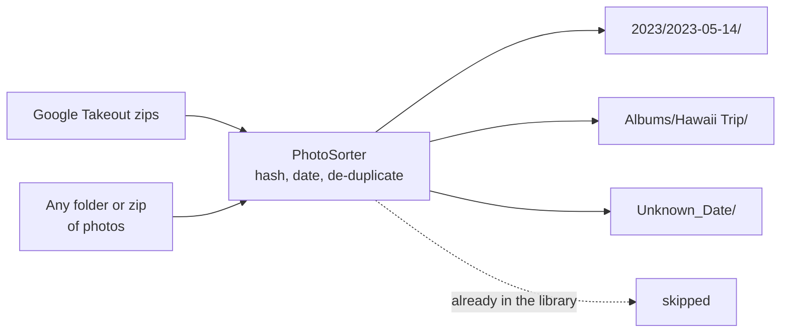
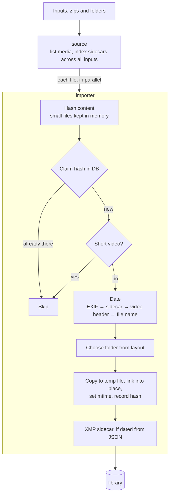

# PhotoSorter

PhotoSorter copies photos and videos into a folder library sorted by date, and skips anything the library already has. It's built for [Google Takeout](https://takeout.google.com/) exports of Google Photos, but any folder or zip of photos works.

- **No duplicates.** Files are identified by a hash of their content, so re-running an import or importing overlapping exports is safe.
- **Correct dates.** Each file is dated from EXIF, Google's JSON sidecars, video metadata or the file name, and its modification time is set to match.
- **Google's metadata kept.** When Google stripped it from a file, it's written to an XMP sidecar: capture time, location, description, people, favourite.
- **Albums kept.** Google Photos albums stay together.
- **Works on the zips.** No need to extract Takeout first, though extracted folders work too.
- **Safe.** Never overwrites a file and never leaves a half-copied one behind.



**Contents:** [Download](#download) · [Usage](#usage) · [Browser interface](#browser-interface) · [Adding photos by hand](#adding-photos-by-hand) · [The library](#the-library) · [Dates](#how-dates-are-found) · [XMP](#xmp-sidecars) · [Maintenance](#library-maintenance) · [Reference](#command-line-reference) · [Configuration](#configuration) · [Development](#development)

## Download

Builds of the latest `main` are on the [releases page](https://github.com/ghills/photosorter/releases/latest), each with a `SHA256SUMS.txt`.

| Platform | File |
|---|---|
| Windows | [`photosorter-windows-amd64.zip`](https://github.com/ghills/photosorter/releases/latest/download/photosorter-windows-amd64.zip) |
| Windows on ARM | [`photosorter-windows-arm64.zip`](https://github.com/ghills/photosorter/releases/latest/download/photosorter-windows-arm64.zip) |
| Linux | [`photosorter-linux-amd64.tar.gz`](https://github.com/ghills/photosorter/releases/latest/download/photosorter-linux-amd64.tar.gz) |
| Linux on ARM | [`photosorter-linux-arm64.tar.gz`](https://github.com/ghills/photosorter/releases/latest/download/photosorter-linux-arm64.tar.gz) |
| macOS (Intel and Apple silicon) | [`photosorter-macos-universal.tar.gz`](https://github.com/ghills/photosorter/releases/latest/download/photosorter-macos-universal.tar.gz) |

Unpack it, then double-click `photosorter` to use it [in your browser](#browser-interface), or run it from a terminal.

- **Windows:** double-click `photosorter.exe`, or run `.\photosorter.exe -h` in PowerShell. The builds aren't signed, so SmartScreen may warn the first time. Choose **More info → Run anyway**.
- **macOS:** double-click the `.tar.gz` to unpack it. macOS won't open an unsigned program until you clear its quarantine flag, so run this once in Terminal from that folder:

  ```bash
  xattr -d com.apple.quarantine photosorter
  ```

  After that, double-clicking it in Finder works.
- **Linux:** `tar -xzf photosorter-linux-amd64.tar.gz && ./photosorter -h`. The browser interface's file pickers need `zenity` or `kdialog`.

### Building from source

You need Go 1.23 or newer:

```bash
git clone https://github.com/ghills/photosorter.git
cd photosorter
go build -o photosorter .
```

## Usage

Import a Takeout export into `~/Pictures/Library`:

```bash
photosorter -out ~/Pictures/Library ~/Downloads/takeout-*.zip
```

> [!IMPORTANT]
> Pass every part of a multi-part export in the same run. A sidecar sometimes ends up in a different zip from its photo, and they can only be paired if both are seen.

> [!TIP]
> Add `-dry-run` to any command to see what would happen without writing anything.

### Common tasks

`photosorter -h` lists these too.

| To | Run |
|---|---|
| Import a Takeout export | `photosorter -out ~/Photos ~/Downloads/takeout-*.zip` |
| Add a folder or zip, dated from the files themselves | `photosorter -out ~/Photos ~/Desktop/phone-backup` |
| Give every file a date | `photosorter -out ~/Photos -date 2019-07-04 ~/Desktop/fireworks` |
| ...and name the folder | `photosorter -out ~/Photos -date 2019-07-04 -event Fireworks ~/Desktop/fireworks` |
| Use a year or month only | `photosorter -out ~/Photos -date 2004-08 -event "Lake house" ~/Scans/box2` |
| Date only files that have no date | `photosorter -out ~/Photos -fallback-date 1998 ~/Scans/mixed` |
| Keep a batch together as an album | `photosorter -out ~/Photos -album Wedding ~/Downloads/wedding-photos.zip` |
| Register files copied into the library by hand | `photosorter -out ~/Photos -sync` |
| Re-hash everything after editing photos in place | `photosorter -out ~/Photos -rehash` |
| Let deleted files be imported again | `photosorter -out ~/Photos -prune` |
| Move old `2023-05-14/` folders into year folders | `photosorter -out ~/Photos -reorganize` |

## Browser interface

Run `photosorter` with no arguments, or double-click it, and it opens a page in your web browser. `-ui` does the same, and prefills the page from any other flags:

```bash
photosorter -ui -out ~/Pictures/Library
```

The page asks whether to **Import photos** or **Maintain the library**, then shows only that task's options:

- **Import:** library, inputs (picked with the system file dialog or typed), dry run, `-date` or `-fallback-date`, `-event` or `-album`, and `-albums`.
- **Maintain:** library, dry run, and any of sync, rehash, prune and reorganize.

A run does only the chosen task, even if `photosorter.toml` turns on maintenance (the [automatic sync](#sync-rehash-and-prune) still happens). On the command line you can combine them. Started with maintenance flags and no inputs, such as `-ui -sync`, the page opens on maintenance.

Good to know:

- **Settings.** Everything else comes from the library's [`photosorter.toml`](#configuration). The page shows which file it used and re-reads it for every run.
- **Paths.** Typed paths must be absolute (`/Users/you/Pictures`, `C:\Photos`). `~` means your home folder.
- **Output.** Same as the command line, including the log file.
- **Stopping.** **Stop** works like Ctrl-C, so it's safe to run again. PhotoSorter keeps running until you click **Quit PhotoSorter**, press Ctrl-C or close its terminal.
- **Access.** The page is served only on `127.0.0.1` and needs the random token in its address.

## Adding photos by hand

Any folder or zip is a valid input. These flags help with scans, a friend's photos, or a camera with the wrong clock. They apply to one run, so they can't go in the config file.

| Flag | Effect |
|---|---|
| `-date YYYY[-MM[-DD]]` | Every file gets this date, even one with its own. The summary counts files whose own date differed, and the log lists them |
| `-fallback-date YYYY[-MM[-DD]]` | Files with no date get this one instead of going to `Unknown_Date/` |
| `-event <name>` | Adds a name to the dated folders |
| `-album <name>` | Puts everything in `Albums/<name>/`, whatever its date |

Use one of `-date` and `-fallback-date`, and one of `-event` and `-album`.

### Where files land

With the default layout:

| Flags | Folder |
|---|---|
| `-date 2019-07-04` | `2019/2019-07-04/` |
| `-date 2019-07` | `2019/2019-07/` |
| `-date 2019` | `2019/` |
| `-date 2019-07-04 -event Fireworks` | `2019/2019-07-04 Fireworks/` |
| `-date 2019 -event Scans` | `2019/2019 Scans/` |
| `-event Hawaii` | each file's own date plus the name, e.g. `2023/2023-05-14 Hawaii/` |
| `-fallback-date 1998` | dated files as usual, undated ones in `1998/` |
| `-album "Grandma's box"` | `Albums/Grandma's box/` |

With a custom `-date-format`, a partial date fills the parts of the layout it can: `2006/01` with `-date 2019-07` gives `2019/07/`. Event and album names can't contain `/ \ : * ? " < > |`, so they work on every OS.

> [!NOTE]
> Files already in the library are still skipped, so re-importing with a different `-date` won't move them.

## The library

```
Library/
├── 2023/
│   ├── 2023-05-14/                  IMG_1234.jpg, IMG_1234.jpg.xmp, VID_5678.mp4
│   └── 2023-05-15/
├── Albums/
│   └── Hawaii Trip/                 media from a Google Photos album
├── Unknown_Date/                    files with no date
├── photosorter.toml                 optional settings
├── .photosorter_cache.db            hash database
├── .photosorter-tmp/                in-progress copies, cleared at the start of each import
└── photosorter_20231012_120000.log  per-run log (dry runs log to the system temp folder)
```

If a name is taken, the new file gets a suffix (`IMG_1234_1.jpg`). Existing files are never overwritten. Folder names and album handling are [configurable](#command-line-reference).

## How dates are found

PhotoSorter uses the first of these that works:

1. **EXIF** `DateTimeOriginal`, from JPEG, TIFF and HEIC.
2. **Sidecar `photoTakenTime`**, the capture time Google recorded.
3. **Video recording time**, from MP4, MOV, M4V and 3GP. Apple devices store a local time with its UTC offset, which is used as is. Otherwise it's the movie header's creation time, which many encoders leave empty. This comes after the sidecar because apps that re-encode video often reset it.
4. **Sidecar `creationTime`**, the upload time.
5. **File name**, such as `IMG_20230514_…`, `VID-2023-05-14…`, `Screenshot_2023-05-14…` or `WhatsApp Image 2023-05-14…`.

If none works, the file goes to `Unknown_Date/` or gets the `-fallback-date`. `-date` overrides all of them.

### Time zones

Sidecar and movie-header times are absolute instants, so the day they fall on depends on the time zone: the machine's, or `-tz`. EXIF times and Apple video dates are local times and are used as recorded. A few cameras write local time into the movie header instead of UTC, so their videos can land a day off around midnight.

Each copy's modification time is set to its date, so viewers that sort by it show photos in order. EXIF times, `-date` and `-fallback-date` have no zone, so they're read in the `-tz` zone, and a partial date such as `2019-07` gives midnight on the first of the month. Undated files keep the time they were copied.

### Sidecar matching

Takeout names sidecars inconsistently. For `IMG_1234.jpg`, PhotoSorter tries:

| Sidecar | Source |
| --- | --- |
| `IMG_1234.jpg.json` | Older exports |
| `IMG_1234.jpg.supplemental-metadata.json` | Newer exports |
| `IMG_1234.json` | Named after the stem |
| `IMG_1234.jpg.supplem.json` | Truncated to Takeout's 51-character limit |
| `IMG_1234.jpg(1).json` | Belongs to `IMG_1234(1).jpg`; Takeout moves the counter to the end |

Edited copies (`IMG_1234-edited.jpg` and its German, French, Italian and Spanish equivalents) fall back to the original's sidecar. Sidecars are matched across every zip in the run.

## XMP sidecars

Takeout strips EXIF from many files and keeps the metadata only in its JSON. When a file is dated from that JSON, PhotoSorter writes `IMG_1234.jpg.xmp` next to the copy so digiKam, darktable, ExifTool and similar tools can read it. The media file itself is never changed.

| Takeout JSON | XMP |
| --- | --- |
| `photoTakenTime` | `exif:DateTimeOriginal`, `photoshop:DateCreated` (in the `-tz` zone, with offset) |
| `geoData`, or `geoDataExif` if empty | `exif:GPSLatitude`, `exif:GPSLongitude`, `exif:GPSAltitude` |
| `description` | `dc:description` |
| `people` | `Iptc4xmpExt:PersonInImage` |
| `favorited` | `xmp:Rating` 5 |

- Files dated any other way keep their own metadata and get no XMP.
- A file dated from `creationTime` gets no capture time in its XMP, since that's the upload time. If nothing else is left to write, it gets no XMP.
- An existing `.xmp` is never replaced. That's counted as a failed sidecar, and the media is still imported.
- `-reorganize` moves sidecars with their files. `-no-xmp` turns them off.

## Library maintenance

### Sync, rehash and prune

Each file is hashed with [xxHash](https://github.com/cespare/xxhash) and checked against `.photosorter_cache.db` before anything is written. The database only knows about files PhotoSorter has seen, so:

- **`-sync`** hashes files you added to the library by hand. It's incremental: files whose path, size and modification time haven't changed aren't read again.
- **`-rehash`** hashes every file, for when an editor changed photos without changing their size or timestamp.
- **`-prune`** syncs, then forgets hashes whose files are gone, so they can be imported again. Deleted files otherwise stay remembered, which stops photos you removed on purpose from coming back. A prune is skipped if the library has no media or any file can't be read.

A sync also runs automatically when the database is empty but the library has media (such as the first run on an existing library), or when the library holds more media than after the last run. `-no-sync` turns this off.

### Reorganize

Older versions put dated folders at the top of the library (`2023-05-14/`). `-reorganize` moves each one, with its contents, into its year folder. Renamed folders keep their names: `2025-10-02 foo bar/` becomes `2025/2025-10-02 foo bar/`.

- **Named with a year** (`2023-05-14`, `2023 Christmas`): goes to that year.
- **Anything else** (`Road trip/`): moves only if every media file inside has a date (EXIF, video recording time or file name) and they all fall in the same year. Otherwise the run says why it left it.
- **Left alone:** year folders, the unknown-date and albums folders, hidden folders and loose files.

If the target folder exists, the two are merged. A file with the same name and content as one already there is removed. One whose name is taken by different content gets a `_N` suffix. The database follows the moves, so no re-sync is needed.

> [!TIP]
> Reorganizing is safe to repeat, and running it again finishes an interrupted merge. Every move is logged, and `-dry-run` shows what would move.

## Command-line reference

```
photosorter -out <library> [flags] [zip | folder ...]
photosorter [-ui] [flags]
```

Positional arguments are inputs: folders are treated like `-in`, everything else like `-zip`. The inputs and the library can't contain each other.

| Flag | Default | Description |
| --- | --- | --- |
| `-out <folder>` | *(required)* | Library folder |
| `-in <folder>` | | Import a folder, e.g. an extracted Takeout. Repeatable |
| `-zip <file or glob>` | | Import a zip, e.g. `"takeout-*.zip"`. Repeatable |
| `-date <YYYY[-MM[-DD]]>` | | Give every file this date. CLI only |
| `-fallback-date <YYYY[-MM[-DD]]>` | | Give this date to files that have none. CLI only |
| `-event <name>` | | Add a name to the dated folders. CLI only |
| `-album <name>` | | Put everything in `Albums/<name>/`. CLI only |
| `-ui` | on with no arguments | Open the browser interface. CLI only |
| `-config <file>` | `<out>/photosorter.toml` | Settings file. CLI only |
| `-dry-run` | off | Write nothing: no files, database changes or library log |
| `-sync` | off | Hash new or changed library files |
| `-rehash` | off | Hash every library file |
| `-prune` | off | Sync, then forget hashes of deleted files |
| `-reorganize` | off | Move top-level dated folders into year folders |
| `-no-sync` | off | Never sync automatically (`-nosync` also works) |
| `-no-xmp` | off | Don't write XMP sidecars |
| `-tz <zone>` | machine's zone | IANA zone for absolute timestamps, e.g. `America/New_York` |
| `-date-format <layout>` | `2006/2006-01-02` | Go time layout for dated folders. Slashes nest; `2006-01-02` gives the old flat layout |
| `-unknown-dir <folder>` | `Unknown_Date` | Folder for undated files |
| `-albums folder\|ignore` | `folder` | Keep albums together, or file their media by date |
| `-albums-dir <folder>` | `Albums` | Parent folder for albums |
| `-include-ext <list>` | | Extra extensions to import, e.g. `dng,arw` |
| `-exclude-ext <list>` | | Extensions to skip, e.g. `gif` |
| `-skip-short-videos <s>` | 3 | Skip MP4, MOV, M4V and 3GP clips this long or shorter (motion photos). 0 keeps all. Skipped clips aren't recorded, so a lower value later imports them |
| `-workers <n>` | 8 | Files processed at once |
| `-max-buffer-mb <MB>` | 16 | Files up to this size are read into memory once. 0 disables. Peak memory is about workers × MB |

Built-in extensions: `jpg jpeg png gif webp heic bmp tiff tif mp4 mov avi mkv webm mts 3gp m4v`. macOS `._*` files and `__MACOSX/` folders are always ignored.

### Exit codes

| Code | Meaning |
| --- | --- |
| `0` | Everything was processed |
| `1` | A fatal error, or some files failed (see the log) |
| `130` | Interrupted by Ctrl-C or SIGTERM. Finished files are recorded, so run again to continue. A second Ctrl-C exits immediately |

## Configuration

Any flag not marked CLI only can be set in a TOML file: `<library>/photosorter.toml` is picked up automatically, or pass `-config`. Later layers win:

**built-in defaults → config file → command-line flags**

```toml
tz = "Europe/London"

[layout]
date_format = "2006/01"      # 2023/05/
unknown_dir = "Undated"
albums = "ignore"

[media]
include_ext = ["dng"]
exclude_ext = ["gif"]
```

[`photosorter.example.toml`](photosorter.example.toml) documents every key. Unknown keys are an error, so typos don't go unnoticed.

## Development

```bash
go test -race -count=1 ./...
gofmt -l . && go vet ./...
go run honnef.co/go/tools/cmd/staticcheck@2024.1.1 ./...
```

CI runs all of these on Linux and macOS.

### How it works



Copies go to a temp file and are hard-linked into place under a free name (or renamed over a reserved name where hard links aren't supported). With album folders on, album files are imported first, so a photo Takeout also put in a year folder lands in its album. Hashes are written to the database in batches. If a write fails, the run stops rather than import files it can't remember. Run only one import per library at a time.

### Project layout

| Path | Responsibility |
| --- | --- |
| [`main.go`](main.go) | Signal handling, then `cli.Run` |
| [`internal/cli`](internal/cli) | Flags, config loading, running and summarising an import, exit codes, log file; starts `ui` |
| [`internal/config`](internal/config) | `Config` struct, defaults, TOML loading, validation |
| [`internal/source`](internal/source) | Zip and folder inputs |
| [`internal/takeout`](internal/takeout) | Sidecar matching, sidecar JSON, album folders |
| [`internal/media`](internal/media) | File types, EXIF, video headers, file-name dates |
| [`internal/library`](internal/library) | Hash database, sync, reorganize, safe file placement |
| [`internal/xmp`](internal/xmp) | XMP sidecar writing |
| [`internal/importer`](internal/importer) | Per-file pipeline, folder layout, atomic writes, run report |
| [`internal/parallel`](internal/parallel) | Worker pool with a progress bar |
| [`internal/ui`](internal/ui) | Browser interface: local server, embedded page, native file pickers |

Each package's `doc.go` explains its design (`go doc ./internal/importer`).

**Dependencies** (all pure Go): [xxhash](https://github.com/cespare/xxhash), [go-sqlite](https://github.com/glebarez/go-sqlite), [goexif](https://github.com/rwcarlsen/goexif), [toml](https://github.com/BurntSushi/toml), [progressbar](https://github.com/schollz/progressbar).
